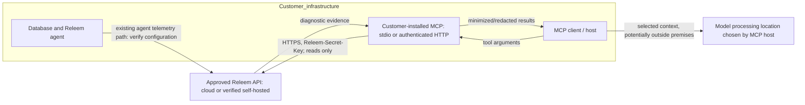
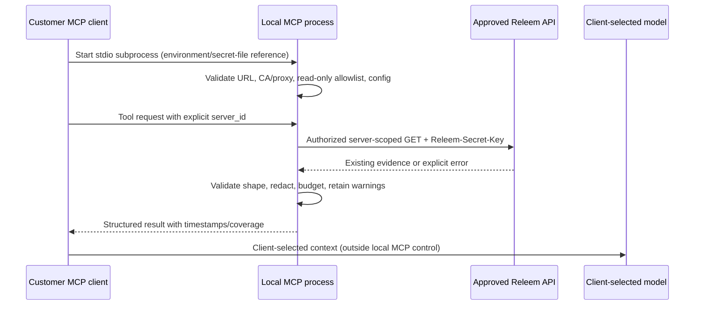
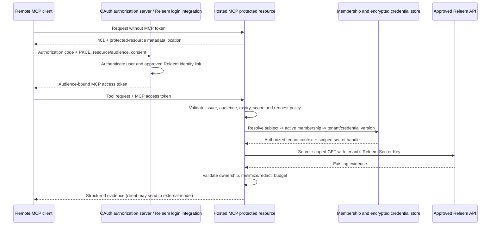

# mcp-releem architecture and phased implementation plan

**Status:** architecture proposal with first local slice implemented after explicit user authorization. See [implementation status](../implementation-status.md). **Evidence date:** 2026-11-10, research started `2026-11-10T15:00:08Z`.

**Goal:** help developers, DevOps engineers, SREs and DBAs investigate databases and understand existing Releem recommendations, with identical diagnostic contracts in customer-installed and hosted deployments.

**Architecture:** one shared diagnostic core and two deployment profiles. Keep transport, identity, tenant credentials and operator configuration outside the diagnostic functions. Start with explicit read-only capabilities; add authenticated hosting after local behavior and API semantics are established.

**Technology proposal:** Python 3.12, official MCP SDK 2.3.0, Pydantic, async HTTP client, uv, pytest/Ruff/mypy, Linux containers. These are research-backed candidates, not a tested lockfile. The original planning delivery supplied no runtime code. Subsequent Phase 0 evaluation is tracked in [compatibility results](../clients/compatibility.md); product integration/release gates remain open.

## 1. Recommendation, assumptions and alternatives

Choose **one codebase with two profiles**: `local` for stdio/customer infrastructure, and `hosted` for authenticated HTTPS. Run the same authorization-aware diagnostic services, schemas, redaction and result-budget code in both. HTTP identity and credential resolution differ; tool names, arguments and evidence semantics do not. Test parity using identical synthetic fixtures.

| Approach | Benefits | Cost/risk | Decision |
|---|---|---|---|
| Shared core, local and hosted adapters | One tool contract, one API client, reproducible offline tests; small container | Requires explicit request-scoped identity instead of process globals | Recommended |
| Separate local and hosted implementations | Independent release/runtime choices | Duplicates semantics, security fixes and fixtures; increases drift | Reject until runtime constraints demonstrably require it |
| Extend existing execution harness | Some existing HTTP/fixture knowledge | Execution-first models, simulated context and token handling conflict with diagnostic product | Replace on this branch; retain historical assessment evidence |

Assume “mcp-coroot” means **jamesbrink/mcp-coroot**, the community Python adapter, not [Coroot's native integration](https://docs.coroot.com/mcp/overview/). Reuse patterns, not Coroot authentication or resource IDs.

Initial API target is **Releem cloud** at **`https://api2.dev.releem.com`**, explicitly confirmed by the user on 2026-11-10 as the same origin that serves Swagger. Self-hosted Releem API support is **UNCONFIRMED**. An administrator-set custom URL supports enterprise routing only after its API version and behavior pass the same contract suite. Confirm whether the supported product must cover cloud, self-hosted APIs, or both; this changes certification/support scope, not the core tool design. This supersedes the initial documentation-only designation of that host. URL approval does not establish deployed API behavior, self-hosted parity or agent compatibility. The [captured contract](evidence/releem-openapi-2026-11-10.json) advertises only a relative server URL.

“Customer-installed” locates the MCP process; it does not locate the Releem API or model. The adapter calls the configured API; the MCP host sends selected results to its chosen model provider. No air-gap or on-premises data-residency claim is justified without verifying the API, agent, client and model path end to end. The adapter itself needs no model API key and makes no model calls.

Prior session deployment choices in the continuity ledger are superseded for this new product. No Cloudflare, Kubernetes, change engine, execution monitoring or rollback framework is inherited. Cloudflare can be evaluated later against measured runtime requirements; initially prefer the existing Releem container platform if available.

## 2. Evidence and what to reuse

The [source register](source-register.md) records source URLs, commit IDs, versions, observed source dates and capture hashes. The [coverage appendix](api-coverage.md) inventories **all 45 operations**, with exact inputs, response shapes, time/pagination rules, effects, sensitivity, documented role constraints and uncertainty. Distribution: **26 MVP reads, 8 later mutations, 11 excluded operations**. These are endpoint coverage counts, not tool counts or live endpoint validation.

| Reference pattern | Decision | Releem adaptation / rejection reason |
|---|---|---|
| Focused diagnostic tools and optional groups | Reuse | Ten job-oriented reads; detailed incident artifacts can be disabled by operator policy |
| Typed arguments, API client separate from tools | Reuse | Pydantic discriminated input unions; explicit server ownership |
| Compact results and useful error messages | Adapt | Preserve unknown/decode states, units, provenance and completeness; never expose raw errors blindly |
| Environment settings and redacted check command | Reuse | Strict URL/trust policy; secret presence only, no values or fingerprints |
| Prompts/resources | Adapt | Releem workflows and static capability/semantics reference; no customer inventory resource duplication |
| Read-only registration filtering | Strengthen | Default true; enforce again at dispatch and outbound operation allowlist |
| Shared state/client lifetime | Adapt | Tenant/subject/credential-version scoped state, not process-global customer credentials |
| HTTP listener | Reject as security boundary | Reference CLI/app does not install listener authentication; require an authenticated boundary for shared HTTP |
| Coroot session/key/ID rules | Reject | Releem uses its own header and server-scoped identifiers |
| Packages, Docker, offline tests | Reuse | Pin versions and container digests; synthetic fixtures and transport parity tests |

Actual [app source](https://github.com/jamesbrink/mcp-coroot/blob/b089b7208bdce6c776b09b5221adb14db7ca0600/src/mcp_coroot/server/app.py), [CLI](https://github.com/jamesbrink/mcp-coroot/blob/b089b7208bdce6c776b09b5221adb14db7ca0600/src/mcp_coroot/cli.py), client base, compacting, error guards and configuration were inspected. If implementation copies substantial MIT-licensed code, retain the upstream notice and include third-party notices; prefer fresh domain-specific code. No runtime source was copied in this task.

Existing local source at `4295c76` was verified before cleanup: `ReleemClient` sets `Releem-Secret-Key`; `ReleemExecutor` submits schema task type 6; `server.py` exposes change workflows and treats MCP bearer tokens as upstream credentials. Reuse only endpoint knowledge and fixture-injection ideas after review. Do not reuse recorded customer fixtures by default. The supplied 2026-11-06 assessment path was absent, so its claims are not evidence for the new architecture. The separate harness can coexist as a separately named product if needed, with distinct credentials, tool discovery and releases.

## 3. Capability and tool contracts

### Common types and controls

All tool names below are proposed public names without an implicit default server. `ServerId` is a canonical positive decimal **string**; retain the upstream value. Reject ambiguous hostname resolution with candidate IDs and minimal names, never silently select a match. Positive child IDs remain integers where lossless. `event_id` is a canonical decimal string in MCP input/output because upstream supports UInt64 beyond JavaScript's exact integer range; validate 1..18446744073709551615 and encode losslessly for the integer path. Preserve query fingerprints as strings, never reinterpret as numbers. Percentages remain percentages; timestamp fields identify seconds versus milliseconds explicitly.

`Window={start_time: offset-aware ISO datetime,end_time: offset-aware ISO datetime}`; require start < end and normalize to UTC. Even where upstream accepts naive times, MCP rejects them to avoid ambiguity. Default windows are resolved once using an injected UTC clock, returned explicitly in the result. Upstream boundary semantics are retained; unknown inclusivity is labeled unknown, not guessed.

`Page={limit:int=20 [1..100],offset:int=0 [0..10000]}` applies **only** to recommendation/event upstream pagination. For newest-first limit-only endpoints, `limit` is a bounded retrieval cap, not a cursor. Do not invent offsets. Filters have bounded string lengths (schema/metric names 256, fingerprints 256, regex 512), are encoded as path segments/query values, and never interpolated into URLs. Initial cap of eight optional hostname filters, each <=253 characters. The API accepts more; MCP deliberately narrows its exposure.

All ten tools use MCP annotations `readOnlyHint=true`, `destructiveHint=false`, `idempotentHint=true`, `openWorldHint=true` (Python SDK fields use snake_case). They describe application effects, not confidentiality. Authentication, authorization and operation allowlists enforce policy independently of annotations. All upstream content is untrusted evidence. No tool takes a credential, tenant ID, base URL, arbitrary path or SQL to execute. No generic request tool.

Common access class **R**: authenticated local configuration or verified HTTP principal, proposed `diagnostics:read` MCP scope, authorized tenant membership, and upstream access to the explicit server. Scopes here are **our proposed MCP scopes**, not claimed Releem OAuth scopes. No upstream role matrix proves `viewer` authorization everywhere: confirm it, reject unexpected 403, and never elevate. Each child lookup includes its server parent; verify returned server IDs where present. For child payloads lacking a server field, use only the verified server-scoped route; a cached child ID is never sufficient authorization.

Common output `Result<T>`:

```text
schema_version: "1"
status: "ok" | "partial" | "no_data" | "error"
data: T | null
scope: {server_id?: ServerId, credential_version: opaque nonsecret revision}
evidence: [{operation_id, fetched_at, observed_at?: ISO|null,
            effective_window?: Window, engine?: string|null,
            sampling?: string|null, units?: string|null}]
coverage: {requested, fetched, returned, omitted?: int|null, complete: bool,
           upstream_total?: int|null, next_offset?: int|null,
           snapshot_consistent: bool|null, truncated_fields: string[]}
warnings: [{code, message}]
redaction: {policy_version, removed_field_counts}
error?: {code, message, retryable, upstream_status?, request_id, next_action}
```

`no_data` means no evidence available, never healthy. `partial` retains independently successful results and component-specific errors. A single successful component cannot hide failed siblings. Distinguish unknown report timestamp from fresh data. Use MCP structured output plus a short matching text summary; tool failures mark MCP `isError`; transport authentication failures remain HTTP 401/403. Output schema casing must be tested against the pinned SDK. Avoid duplicating full JSON in text.

Budget defaults: 24 KiB serialized structured result plus <=2 KiB text, maximum 64 KiB combined; 100 rows, 500 series points per metric, four metrics per request, four concurrent upstream calls per tool, eight total upstream requests per call. `server_findings` uses at most five reads. Inventory endpoints with no upstream bounds use a 5 MiB response-body ceiling and fail actionably if exceeded; narrow filters rather than downloading without limit. Stream-decode and enforce bytes before deserialization. Per-tool hard limits cannot be raised by a model.

Preserve warnings, scope, timestamps and omissions before reducing data rows. If protected metadata itself cannot fit, return a bounded `result_too_large` error with narrowing advice. Never silently discard material findings. Output `coverage.complete=false` when clipped, filtered to a subset or when the upstream endpoint is itself a capped list. Distinguish completeness of the requested window/filter from all-server/all-time coverage. For offset pages, record `has_more` as true/false/unknown if needed; no invented total. For metric overflow ask for a coarser interval or smaller window; do not silently convert samples to a different statistic.

### Ten MVP read tools

Operation IDs refer to the **exact method/path** in the [matrix](api-coverage.md). Discriminated `view`/`mode` inputs combine related reads, never reads and writes. All outputs are `Result<T>` and inherit R and the common failure contract.

| Tool / job | Exact mapping | Typed input and defaults | Output sketch / sensitivity | Example |
|---|---|---|---|---|
| `servers`: discover targets | O05 `GET /v1/servers` | `{hostname?:list[str],limit:int=20 [1..100]}`; local output cap only, upstream exact-hostname filter | `ServerSummary[] {id,name,status,engine_version?,agent_version?}`; S1/S3 upstream, omit IPs/users | `servers({"hostname":["db-example"]})` |
| `server_findings`: metadata, health, security, schema | O07 `GET /v1/servers/{id}`; O14 `/details`; O15 `/health-checks`; O16 `/security-checks`; O35 `/schema-checks` (all GET) | `{server_id,sections:set["summary","health","security","schema"]=["summary","health","security"],schema_name?:str,check_type?:enum}`. Summary uses O07+O14; other sections map one-to-one; max five reads | `{server?,failed_summary?,reports:[{kind,timestamp,checks,unknown?,decode_error?}]}`; S2; security identities removed | `server_findings({"server_id":"101","sections":["health","schema"]})` |
| `recommendations`: prioritize and explain | O01 `GET /v1/servers/recommendations`; O02 `/v1/servers/{id}/recommendations`; O03 `/v1/servers/{id}/recommendations/{recommendation_id}` | `{view:"list",server_id?:ServerId,type_id?:1..5,category_id?:1..4,source_type?:enum,status?:enum,score_min?:number,score_max?:number,sort:"priority_score_desc"\|"created_at_desc"="priority_score_desc",...Page}` OR `{view:"detail",server_id,recommendation_id:int}` | List `{items,total,limit,offset}` or detail `{recommendation,evidence,current_review,review_history,status_history}`; S2; actor identity removed | `recommendations({"view":"list","server_id":"101","status":"new","limit":10})` |
| `query_evidence`: expensive queries, existing proposals and optimizations | O23 `GET /v1/servers/{id}/query-analytics`; O24 `/query-analytics/{schema_name}/{query_id}/recommendations`; O19 `/query-optimizations`; O21 `/query-optimizations/{optimization_id}` | Union: `{view:"analytics",server_id,period_days:1\|7\|14\|30\|60\|90=1,start_date?:offset-aware datetime,timezone:"UTC"="UTC",sort_by:enum="sum_time_perc_total",order:"asc"\|"desc"="desc",schema_name?,query_filter?,limit=20 [1..100]}`; `{view:"proposals",server_id,schema_name,query_id}`; `{view:"optimizations",server_id,schema_name?,limit=20 [1..100]}`; `{view:"optimization",server_id,optimization_id:int}` | `{effective_window?,queries?\|optimizations?\|proposals?,plans?:available-only}`; S2/S3. Raw query_text omitted; query fingerprints/metrics preferred | `query_evidence({"view":"analytics","server_id":"101","period_days":1,"limit":10})` |
| `configurations`: state/history | O17 `GET /v1/servers/{id}/configurations`; O18 `/configurations/{configuration_status_id}` | `{view:"latest"\|"history",server_id,limit=20 [1..100]}` OR `{view:"detail",server_id,configuration_status_id:int}`. latest sends latest=true; history latest=false | `{states:[{configuration_status_id,configuration_id,status,timestamps,...}],detail?}`; S2; secret variables removed | `configurations({"view":"detail","server_id":"101","configuration_status_id":501})` |
| `metrics`: discover, read, compare | O25 `GET /v1/servers/{id}/metrics`; O26 `/metrics/averages`; O27 `/metrics/byName/{metric_name}`; O28 `/metrics/byId/{itemid}` | `{mode:"catalog",server_id}`; `{mode:"series",server_id,metric_name?:str,itemid?:int,window?:Window,use_trends:bool=false,interval?:str,aggregation?:"avg"\|"sum"\|"min"\|"max"}` exactly one name/id, default last 1h; `{mode:"compare",server_id,current:Window,baseline?:Window,metric_names?:list[str] <=4}` default immediately previous equal duration, two O26 reads | Catalog `{itemid,name,units,value_type}`; series `{metric,units,data,sampling,window}`; compare `{current,baseline,deltas,method:"hourly_trends"}`; S1 | `metrics({"mode":"catalog","server_id":"101"})` |
| `events`: incident timeline/details | O12 `GET /v1/servers/{id}/events`; O13 `/events/{event_id}` | `{view:"list",server_id,window?:Window,...Page}` default last 1h, adapter max 7d; OR `{view:"detail",server_id,event_id:UInt64String}` | `{items:[{event_id,timestamp,name,type,severity}],next_offset?,snapshot_consistent:false}` or sanitized detail; S1 list/S3 detail | `events({"view":"detail","server_id":"101","event_id":"701"})` |
| `deadlocks`: recorded deadlock evidence | O29 `GET /v1/servers/{id}/deadlocks`; O30 `/deadlocks/{deadlock_id}` | `{view:"list",server_id,window?:Window,limit=20 [1..100]}` default last 1h, max 7d; OR `{view:"detail",server_id,deadlock_id:int}` | Summaries or sanitized `{id,timestamp,type,max_active_time,transactions?}`; S2/S3; raw dump omitted by default | `deadlocks({"view":"list","server_id":"101","limit":10})` |
| `captured_sessions`: saved processlist captures | O34 `GET /v1/servers/{id}/processlist` | `{server_id,mode:"latest"\|"window"="latest",window?:Window,limit=5 [1..20]}`; window required in window mode, max 24h. latest omits both upstream times | `{captures:[{timestamp,session_summary,redacted_rows?}],live:false}`; S3; no arbitrary capture creation | `captured_sessions({"server_id":"101","mode":"latest"})` |
| `task_outcomes`: inspect historical agent work | O31 `GET /v1/servers/{id}/tasks`; O33 `/tasks/{task_id}` | `{view:"list",server_id,status?:int,type_id?:int,limit=20 [1..100]}` OR `{view:"detail",server_id,task_id:int}`; no automatic polling | `{tasks:[{id,type_id,status,status_label,exit_code,status_time}],detail?:{report_time,error_summary,output_summary}}`; S3 detail | `task_outcomes({"view":"detail","server_id":"101","task_id":401})` |

Default enabled groups: inventory/findings/recommendations/queries/configuration/metrics and incident history. The latter's sensitive detail is an operator-controlled permission, proposed `diagnostics:sensitive`; without it, list summaries work and detail requests return `sensitive_detail_disabled`. For `events`/`deadlocks` detail, `captured_sessions` and task detail, require both R and that permission. For configuration variables and SQL proposals return only approved allowlisted fields; `diagnostics:sensitive` permits sanitized content, never secrets or a universal raw-data bypass. Hosted policy may remove sensitive tool variants entirely while keeping names/contracts for permitted reads.

`server_findings.check_type` permits only the eight upstream canonical schema-check types: missing_primary_key, unused_index, duplicate_index, auto_increment, collation, character_set, table_engine, table_fragmentation. Query sort enum: sum_time_perc_first, calls, avg_time_ms, sum_time_perc_total. Recommendation source/status enums follow O01/O02 exactly. Validate score_min <= score_max. Cross-server recommendation pages use the upstream tenant token and an additional authorized-server filter; if the filter drops rows, totals become upstream totals with a separate visible count, never a claimed filtered total. If permissions cannot be established safely without unbounded fan-out, disable cross-server mode and require server_id.

### Failure and interpretation rules

Common errors: invalid arguments -> actionable field/value guidance; unauthenticated upstream -> `upstream_auth_failed`, no retry/login/token echo; 403 -> `forbidden`, no fallback credential; 404 -> `not_found_or_inaccessible`, no cross-server existence leak; 422 -> `invalid_arguments` or `invalid_source_data` preserving the distinction; 429 -> bounded backoff/Retry-After; timeout/5xx -> explicit `dependency_unavailable`/`timeout`. Error details are allowlisted, not raw response bodies. Allow at most one retry for documented reads within the overall deadline; no mutation retry machinery in MVP. A missing event payload may produce 404 even when its summary exists; call that out without promising recovery.

Tool-specific invariants:

- Findings distinguish failed-only `/details` from full reports. Preserve security unknown/decode errors; security source 422 remains an error. Null health/security report timestamp means absent snapshot. Schema null timestamp means no completed run; filtered empty results say only that the filter matched nothing.
- Recommendations use `type_id`, never `type`. Inactive accessible servers can return no recommendations; that is not proof of health. `done` is a workflow label, not evidence of applied/effective changes. Reference evidence links are data, never automatically fetched external URLs.
- Query analytics uses `[start_date,start_date+period_days)` or the upstream returned rolling window. Return the actual start/end. Schema filters change percentage denominators. Retain avg_time_ms versus sum_time_sec and upstream percentage names; no synthetic EXPLAIN or missing proposal generation. Normalized text still requires screening.
- Configuration detail uses `configuration_status_id`. Repeated states can share `configuration_id`; no accidental deduplication by logical ID. No configurations means absent evidence, not a default configuration.
- Series windows are <=31d raw or <=366d trends. Aggregation requires interval or trends; interval is positive number plus m/h/d. Averages use hourly trends, with `avg` the mean of hourly averages, not a weighted raw-sample mean. Return this method. Do not compute misleading percent change from baseline zero/null, incompatible units or missing metrics; return null plus reason. No interpolation/zero fill; missing trends return `trends_not_available`. Catalog supplies units absent from series response; budget includes that lookup.
- Event time bounds are inclusive to one-second precision. Offset pagination has no total and is not snapshot consistent; supply the exact window/next offset, warn about duplicates/skips under concurrent arrivals. Deduplicate only within data actually fetched, retaining the warning. Other limit-only lists do not promise exhaustive traversal.
- Deadlocks and processlist reject end without start upstream; MCP passes complete windows. Processlist latest returns a stored capture, not live sessions; recorded timestamp must be visible. Task unknown numeric status/type codes remain numeric with unknown label; missing final output/report is not success.

These semantics derive from the [captured development API](evidence/releem-openapi-2026-11-10.json); verify deployed behavior in a separately authorized synthetic test environment before release.

### Workflow prompts and resources

Prompts only guide existing read tools. They cannot enable groups or grant permissions.

1. **Why is this database slow?** Discover/explicitly select server; read health and prioritized recommendations; compare incident/current and baseline metrics; inspect top query evidence and deadlocks. Report observed changes, timestamps and plausible explanations separately. Name the next evidence needed if inconclusive; do not claim causation.
2. **Which queries deserve investigation?** Ask for server/schema/window, rank by cumulative time share and calls, then inspect existing proposals for up to three fingerprints. Show latency versus total-load tradeoffs, denominator and missing plans. Do not execute SQL or submit optimization.
3. **Explain this recommendation.** Fetch server-scoped recommendation detail and its existing evidence, confirm engine/version applicability and freshness, explain rationale and uncertainty; distinguish recommended action from actual execution/evaluation status.
4. **What changed around this incident?** Align event summaries, configuration states, tasks, deadlocks and metric windows. Mark fetch-time differences, missing historical coverage and offset instability. Correlation is a lead, not causal proof.

Add one static `releem://reference` resource containing supported tools/groups, units/time semantics, status-code tables and applicability limitations; version it with the release. Do not expose a configuration/secrets resource. Defer customer-data resources until actual client reference use justifies another authorized/cached access path.

## 4. Architecture and data/authentication flows



Local stdio lifecycle: client launches CLI; validate required config before serving; one scoped async client per local credential lifecycle; stdout carries MCP only, stderr carries redacted operational logs. EOF/SIGTERM closes HTTP pools, stops pending reads and exits; no orphaned polling. Customer shared HTTP adds its own MCP identity gateway and per-user tenant binding, or an explicitly single-principal restricted service with auditable access policy. Never expose an unauthenticated shared listener. Default bind is 127.0.0.1. Container stdio uses `-i`, no TTY, no published port. A remote HTTP container is a separate invocation with TLS/auth boundary.





The authorization server, membership mapping and credential store are proposed components, not invented Releem endpoints. The [MCP authorization specification](https://modelcontextprotocol.io/specification/2026-07-28/basic/authorization) informs audience validation and metadata discovery; prefer an existing identity provider/integration after a spike, with authorization code + PKCE and exact registered redirect URIs. Validate issuer metadata/JWKS and consent, state and redirect policy. Use asymmetric verification where supported; choose introspection/short TTL where immediate revocation requires it. No MCP token is forwarded as a Releem key, and no upstream key is accepted as an MCP access token.

If Releem cannot delegate an API credential through existing identity, a separately reviewed enrollment UI can bind a user's token to a verified identity: browser authenticated to Releem/IdP; CSRF-protected server enrollment; secure token entry over TLS outside chat; server-side ownership verification through an upstream identity assertion or owner-authorized integration; envelope encryption/KMS; one explicit tenant binding; scope/expiry display; replace/revoke/remove connection UX; revoke upstream separately if deleting stored copy does not revoke the key. A server list alone does not prove customer identity. Enrollment verification without a trusted binding is a **hosted blocker**, not permission to trust model-provided customer IDs. No secrets in chat, URLs, telemetry or example config.

For multiple memberships, bind the connection/grant to an authorized tenant through trusted UI or token claims. If no unique binding exists, fail with `tenant_selection_required`. Tools cannot switch tenants by supplying arbitrary tenant IDs. Perform fresh membership/version checks per request; session/cursor state, if any, never grants authority.

### Smallest viable hosted arrangement

One managed Linux container service with HTTPS ingress and an existing OAuth-capable IdP; existing relational store if available for membership/credential metadata; managed secret storage/KMS. A single instance is sufficient for a bounded pilot, accepting maintenance downtime; two replicas are a production availability decision. No Kubernetes, message broker or durable task queue is needed for bounded read requests. Reuse existing platform components only after confirming they provide the required isolation and audit controls.

Use stateless current-revision HTTP, request-local identity/context and bounded pooled clients keyed by `(tenant, subject/permission-set, credential_version, approved_base_url)`; evict idle pools after 5 minutes, cap total pools. Default no cross-request diagnostic caching. If needed later: <=30s TTL, same complete key plus server/operation/arguments and redaction policy; immediate invalidation on membership/credential revision changes. Never cache by server ID alone. No full bearer token as a cache key or log identifier. No shared privileged upstream token plus customer ID routing.

Current MCP **2026-07-28** is sessionless and removes the GET stream. Do not build new business behavior on protocol sessions; the pinned SDK has an automatic legacy compatibility path, exercised by the Phase 0 synthetic tests. Exact client application onboarding remains unverified. If enabled, bind any compatibility session to principal/tenant/credential version, expire it and reauthorize each request. No session IDs as authentication. Horizontal scale should not require sticky affinity for MVP reads. [Transport binding](https://modelcontextprotocol.io/specification/2026-07-28/basic/transports/streamable-http), [Python v2 changes](https://py.sdk.modelcontextprotocol.io/whats-new/).

Proposed pilot limits: 60 tool calls/minute/principal, 300/minute/tenant, four active tools/tenant, 32 globally/replica, four concurrent upstream reads/tool. Set a 30s total deadline, connect timeout 3s, upstream read timeout 10s; at most one jittered read retry within deadline. Return overload/429 with Retry-After; do not queue indefinitely. Cancellation stops outstanding reads/pool waits; proxy/request disconnect handling follows SDK semantics. Container shutdown stops admission then drains up to 30s. Dependency outages fail visibly; readiness checks process/config/identity dependencies without customer credentials; liveness never probes customer servers. Track upstream failure rate/circuit state without silently substituting stale data.

TLS externally and upstream; verify enterprise CA rather than disabling TLS. Restrict Host/Origin against operator policy, reject invalid present Origins, trust forwarded headers only from configured proxies; no wildcard credentialed CORS. Bound request bodies (64 KiB), tool-argument depth and response bodies. Internal admin/health ports are not the public MCP tool surface. [HTTP security requirements](https://modelcontextprotocol.io/specification/2026-07-28/basic/transports/streamable-http).

Hosted upstream URL is operator-owned and allowlisted. Reject model/tenant-specified hosts, URL userinfo, query/fragment, disallowed ports/schemes; redirects disabled. DNS resolution/egress must reject private/link-local/metadata/reserved ranges and rebinding, including IPv6 and alternate encodings, unless an explicitly provisioned private connector authorizes that destination. Network policy enforces this in addition to validation. Local private URLs/proxies are allowed only through administrator configuration, never tool input; disable redirects there too. Enterprise proxy egress/credential handling is part of the trust boundary.

## 5. Technology, modules, configuration and client delivery

Choose Python for the shared core: it matches existing team/repository context and the reference's patterns, supports typed validation and async API calls, and deploys unchanged in customer/hosted Linux containers. Choose it for maintenance/reuse of concepts, not to preserve the old engine.

| Candidate | Verified as of research date | Fit / cost |
|---|---|---|
| Python official SDK | `mcp==2.3.0`, `mcp-types==2.3.0`; v2 MCPServer | Preferred; validate release APIs against 2026-07-28 and selected legacy clients; current docs can run ahead |
| TS official SDK | Current split server/client `2.4.0`, Node adapter `2.1.2`; Node >=20 | Strong schemas/middleware/OAuth and web-team fit; adds a different runtime/maintenance path here |
| Legacy TS package | `@modelcontextprotocol/sdk==1.32.2` | Not the current v2 alternative; do not choose because its package name is familiar |
| Supporting Python candidates | httpx2 2.16.0, Pydantic 2.14.3, uv 0.13.7, pytest 9.2.0, Ruff 0.17.4, mypy 2.4.1, Hatchling 1.33.0 | Resolve/lock in container, review licenses and advisories before adoption; not a claim all versions were tested together |

Sources: [Python release metadata](https://pypi.org/pypi/mcp/json), [Python SDK](https://github.com/modelcontextprotocol/python-sdk), [TS SDK v2](https://github.com/modelcontextprotocol/typescript-sdk), and individual primary registry URLs in the [register](source-register.md). Python 3.12 is a deliberate supported runtime baseline, not a claim of latest Python. Use one SDK, not a second unrelated FastMCP dependency. Do not pin old dependency ranges from mcp-coroot blindly.

Suggested future repository boundaries (not created runtime files):

```text
src/mcp_releem/
  cli.py, config.py                 lifecycle/settings and redacted --check
  api/client.py, errors.py          HTTP, timeouts, schema/error translation
  api/models/{domain}.py            selected typed upstream contracts
  core/{servers,findings,queries,configurations,metrics,history}.py
                                   diagnostic jobs; API client injection
  core/envelope.py, time.py         provenance/budgets and clock semantics
  security/context.py, policy.py   immutable principal/tenant and operation access
  security/redaction.py, urls.py   field policy and operator-owned destinations
  mcp/app.py, tools/{domain}.py     schemas, discovery, dispatch, annotations
  mcp/prompts.py, resources.py      workflows and static reference
  profiles/local.py, hosted.py     configuration and credential resolution
  hosted/identity.py, credentials.py, audit.py
                                   auth integration, vault handles, metadata logs
contracts/                         reviewed contract and drift manifests
tests/{unit,contract,transport,security}/
tests/fixtures/synthetic/          synthetic data only
Dockerfile, compose.test.yaml      nonroot runtime and hermetic test workflow
pyproject.toml, uv.lock             package/dependency controls
README.md, docs/clients/, docs/operations/, prompt.md
```

Keep modules <=300 handwritten nonblank/noncomment lines; split by responsibility, no speculative repository framework. No execution modules in MVP. Public adapter output models are separate from upstream models so API drift cannot silently change MCP contracts.

Proposed configuration contract; reject unknown options and inconsistent combinations. Values below are not active configuration.

| Setting | Default / policy |
|---|---|
| `RELEEM_MCP_PROFILE` | local; hosted requires identity/credential resolver configuration |
| `RELEEM_MCP_TRANSPORT` | stdio; streamable-http explicit |
| `RELEEM_API_BASE_URL` | Default `https://api2.dev.releem.com`, explicitly user-approved; administrator-controlled override |
| `RELEEM_API_TOKEN_FILE` / `RELEEM_API_TOKEN` | local only; exactly one, file preferred; never command-line argument; no implicit dotenv loading |
| `RELEEM_MCP_READ_ONLY` | true; false rejected by MVP build, not a switch enabling latent writes |
| `RELEEM_MCP_GROUPS` | reviewed diagnostics groups; disabled groups rejected at dispatch |
| `RELEEM_MCP_SENSITIVE_DETAILS` | false; operator policy and per-principal scope both needed for sensitive views |
| `RELEEM_MCP_HOST` / `PORT` / `PATH` | 127.0.0.1 / 8000 / /mcp; shared binding requires authenticated boundary |
| `RELEEM_MCP_PUBLIC_URL` / `AUTH_ISSUER` / `AUTH_AUDIENCE` | required for shared/hosted HTTP; verified allowlisted metadata/keys |
| `RELEEM_MCP_CREDENTIAL_STORE` | hosted secret-manager reference only; process-global upstream token prohibited |
| `RELEEM_MCP_ALLOWED_ORIGINS` / `ALLOWED_HOSTS` | explicit operator allowlist; documented nonbrowser absent-Origin policy |
| `RELEEM_MCP_CA_BUNDLE` / `HTTPS_PROXY` / `NO_PROXY` | operator-managed; use explicit client trust/proxy settings, redact proxy credentials |
| `RELEEM_MCP_ALLOWED_UPSTREAMS` / `ALLOW_PRIVATE_UPSTREAM` | approved origins; private=false hosted; local opt-in administrator policy |
| `RELEEM_MCP_TIMEOUT_S` / `MAX_OUTPUT_BYTES` | 30 / 24576 structured; bounded hard maxima as above |
| `RELEEM_MCP_LOG_LEVEL` | info; no request/response bodies, tokens or raw SQL even in debug |

`--check` validates syntax/policy and prints profile, transport, version, nonsecret approved origin and presence flags only; no network by default. A separate explicit `--check-connection` read probe requires customer authorization/account setup and returns minimal inventory count, not identifiers/keys. Invalid configuration exits nonzero with an actionable redacted error.

### Customer delivery and onboarding

Publish a signed/versioned wheel and sdist with CLI `mcp-releem` and a nonroot Docker image after explicit release approval. Pin package versions or image digests in client instructions; no floating latest in supported examples. CLI installation should use an isolated tool environment (for example uv tool install pinned release), not system Python. Containers carry dependencies; configure read-only filesystem, dropped capabilities, secret file mount and outbound network only. Package and image must run identical schemas and fixture tests.

Placeholder-only examples below describe **future releases**; replace `<VERSION>`/`<DIGEST>` after publication. They are not executed in this task. Secrets are provisioned outside client JSON; no literal credential values. Use a local administrator-created mode-0600 secret file.

Cursor local `.cursor/mcp.json` example (Cursor-specific env interpolation):

```json
{"mcpServers":{"releem":{"command":"uvx","args":["--from","mcp-releem==<VERSION>","mcp-releem"],"env":{"RELEEM_API_BASE_URL":"https://api.example.invalid","RELEEM_API_TOKEN_FILE":"${env:RELEEM_TOKEN_FILE}"}}}}
```

Container stdio invocation shape, configured as a client's command/args; external `<CLIENT_ENV_FILE>` contains only administrator-approved settings and the in-container token-file path:

```sh
docker run --rm -i --read-only --cap-drop=ALL --env-file <CLIENT_ENV_FILE> \
  --mount type=bind,src=<LOCAL_SECRET_FILE>,dst=/run/secrets/releem,readonly \
  <IMAGE>@sha256:<DIGEST> mcp-releem
```

Validate the eventual image entrypoint so this argv is accurate; do not duplicate CLI if ENTRYPOINT already names it. Claude Code remote onboarding uses its documented HTTP path, then browser login via `/mcp`:

```sh
claude mcp add --transport http releem https://mcp.example.invalid/mcp
```

Cursor hosted config shape:

```json
{"mcpServers":{"releem":{"url":"https://mcp.example.invalid/mcp"}}}
```

| Client target | Documentation evidence | Release commitment |
|---|---|---|
| Claude Code | Local stdio and HTTP/OAuth documented | First local and hosted acceptance target; record exact build and auth/transport test receipt |
| Cursor desktop | stdio, HTTP, OAuth and env interpolation documented | Second target; callback registration differs by desktop/web surface |
| Codex, Claude Desktop, other MCP hosts | Not verified in this research | Candidate later onboarding; no universal support claim or guessed config |

[Claude Code documentation](https://code.claude.com/docs/en/mcp), [Cursor documentation](https://cursor.com/docs/mcp). Documentation confirms transport/auth features, not that untested installed versions support every 2026 revision change. Phase 0 must run exact client builds against pinned SDK transport behavior before naming supported versions. If a legacy adapter is necessary, keep it inside presentation/transport and run the same diagnostic contracts; do not fork the core or promise support for deprecated SSE-only servers.

Upgrade: review changelog/contract diff, pin new release, run redacted config check and synthetic transport smoke, restart client/container; keep prior signed image/wheel for downgrade. Uninstall removes the client entry/tool environment/container and local secret file by customer policy; disconnect hosted enrollment and revoke upstream token separately when required. Troubleshooting guide must distinguish launch/PATH, invalid config, CA/proxy failures, HTTP auth/audience/redirect errors, upstream 401/403/429, absent reports, incompatible protocol/client versions and output caps. Stdout pollution is a startup defect. Document every supported OS/client/container architecture actually tested; platform matrix remains UNCONFIRMED until those tests.

## 6. Threat model, permissions and data handling

Assets: upstream API keys, tenant identity/membership, database/query evidence, system metadata, recommendation text, task outputs and audit records. Trust boundaries: model/client -> MCP; ingress/IdP -> hosted app; app -> vault/store; app -> Releem; untrusted upstream content -> client/model.

| Threat | Required control / acceptance evidence |
|---|---|
| Cross-tenant IDOR, changed child parent, guessed server IDs | Request-scoped trusted tenant, server-scoped API routes, ownership checks and permission-aware caches; A credentials cannot fetch B server/child even after reused request/session IDs |
| Token substitution/confused deputy | Verify MCP issuer/audience/scope/expiry; upstream secrets only from authorized resolver; wrong-audience Releem/MCP tokens rejected |
| SSRF/redirect credential exfiltration/DNS rebinding | Operator allowlist, redirects off, DNS/IP and egress enforcement; test metadata IPs, IPv6, private hosts, rebinding and proxy bypass |
| Prompt injection in SQL/logs/recommendations/task output | Label evidence untrusted; no automatic follow-up URLs or command execution; tests prove content cannot enable writes/change tenant/URL |
| Credential/PII leakage | Field allowlists, secret detection defense in depth, sanitized errors, no body logs; nested/raw/delimiter variants and malformed data tested |
| Denial of service/unbounded fan-out | Body/output/deadline/concurrency/page quotas; cancellation and overload tests; no unlimited history fetch |
| Stale authorization or cache poisoning | Membership/credential-version checked per request; revoke invalidates caches/pools; no caching solely by tool/server or bearer token |
| Supply-chain/drift | Reviewed lockfile, image digest, SBOM, dependency/license review, signed releases, schema-diff gates |
| Misdiagnosis from missing/partial data | Null/unknown/decode distinctions, report age, units/window/provenance, explicit truncation; no synthetic success |

| Capability | Local credential owner | Hosted diagnostic user | Optional future operator/admin |
|---|---|---|---|
| Accessible server metadata and minimized diagnostics | Configured credential + operator policy | diagnostics:read + verified membership + upstream authorization | Same, no bypass |
| Sanitized sensitive detail | Explicit local policy | diagnostics:sensitive + tenant policy + upstream authorization | Same authorization applies |
| Recommendation status / optimization submission | Absent MVP | Absent MVP | Separate scoped approvals only after future release review |
| Config/task execution | Absent MVP | Absent MVP | Higher-risk separate capability after agent compatibility and recovery validation |
| Sharing/deletion/customer administration | Excluded | Excluded | Separate admin product decision; never inherit partner authority |

MVP operation policy: exact allowlist of O01/02/03/05/07/12/13/14/15/16/17/18/19/21/23/24/25/26/27/28/29/30/31/33/34/35. O06 is a read but intentionally not allowed yet. Discovery omits mutations; dispatcher rejects unknown/disabled/write names; API client rejects operations outside the allowlist before sending any request. No mutation endpoints in a generic exposed client. Egress HTTP method blocking alone is insufficient because effect classification must be explicit.

Redaction starts from output-field allowlists, not regex alone. Default omit API keys, server users/emails/IPs, raw SQL, SQL literals, task details/output, deadlock dumps and processlist identities. Prefer numeric query metrics and fingerprints; permit length-bounded screened normalized SQL only under approved policy. SQL normalization is engine-aware and is not claimed to prove anonymity; if safe normalization is unavailable omit text and explain. Configuration variable names may be shown only from an approved allowlist; redact secret values/connection strings recursively. Plans/recommendation SQL may contain literals or object names; sanitize and return only where policy permits. Preserve failure severity/reason while removing sensitive spans. No universal “reveal secrets” flag.

Hosted retention proposal: no persistent diagnostic payloads/transcripts, no payload traces, no model prompt logging. In-flight evidence discarded after request; cache disabled initially. Audit metadata retained 30 days for pilot: opaque subject/tenant ID, tool, server reference under access control, permission decision, timing, upstream status, bytes/omission counts and correlation ID; never tokens, SQL or response bodies. Aggregated operational metrics 30 days without customer payload labels. Credential records encrypted under KMS with tenant-bound encryption context, least-privilege app access and access auditing; remove active record on disconnect and purge encrypted backups within 30 days, subject to approved retention policy. Confirm legal/customer retention requirements before pilot; document any different schedule, including backups. Rotation/revocation increments credential revision and invalidates in-flight new access/pools/caches; define whether existing reads are cancelled. Immediate access removal requires membership/token revocation integration; short token TTL alone is not immediate revocation.

### Required upstream/identity confirmations or changes

1. API base URL is confirmed as `https://api2.dev.releem.com`. Confirm supported API/agent versions, engine/provider coverage and on-premises API availability; supply contract version/drift policy.
2. Publish/enforce read-only credentials and per-server roles. The documented `viewer`/`editor` sharing enum is insufficient proof of endpoint enforcement. Diagnostics adapter controls reduce risk but do not remove the API key's privileges.
3. Supply a verifiable identity-to-tenant-to-credential binding and membership-removal/revocation mechanism; integrate OAuth resource/audience and client registration with existing Releem identity or a trusted IdP. No public identity/OAuth endpoint is established by the current OpenAPI.
4. Confirm API token expiry/revocation, rate limits, error codes, ownership behavior and availability of credential scopes. Customer endpoints may return `api_key`; excluding them avoids incidental key disclosure.
5. Confirm reporting freshness/unit/sampling guarantees, missing/unknown semantics and operation-specific RBAC under synthetic accounts. Event snapshot pagination improvements would help; until then expose limitations.
6. Before any writes: agent-supported task code/version matrix, payload contracts, deduplication/idempotency and reconciliation guarantees; chat backend effects, provider/cost/retention. These are prerequisites for those features, not MVP implementations.

## 7. Optional later capabilities and approval semantics

| Toolset | Operations | Proposed access / actual effects | Preconditions and recovery |
|---|---|---|---|
| Recommendation workflow | O04 PATCH status | recommendations:write, editor/owner once verified; new/dismissed/done/outdated labels | Read current status/version; preview target+reason; reconcile status history after timeout; no inferred database application |
| Optimization preservation/submission | O20 POST saved record; O36 POST custom | optimizations:submit; custom creates record **and queues EXPLAIN task type 7** | Confirm engine/query ownership, SQL confidentiality, cost and agent support; reconcile returned record/task IDs; never blind resubmit |
| Optimization workflow linkage | O22 PATCH | optimizations:write; arbitrary upstream status/task link is not a safe generic MCP payload | Constrain supported transitions; same-server task; approved current state and target; reconcile record/task outcome |
| Configuration values | O37 PUT memory bytes; O38 PUT override object | configuration:write, operator; writes persisted settings and may influence later configuration behavior | Distinguish replace from merge; preview diff, backup prior state through verified reads where available; no unsupported automatic rollback |
| Agent tasks | O32 POST | tasks:execute, privileged operator; types 0/1/4/5 configuration, 2 agent update, 3 optimization, 6 schema, 7 EXPLAIN, 8 rollback | Version/engine/provider allowlist, task-specific typed payload, maintenance constraints, verified preconditions and manually approved recovery plan |
| Fleet configuration read | O06 GET | R, bounded fleet capability after load/privacy review | Owner-only versus shared semantics explicit; response-byte bounds and omissions |
| Administrative/customer/chat | O08/09/10/11/41–45 | Excluded from this product release plan; separate design if requested | Partner authority, deletion, sharing, secret-returning data and opaque backend tools need independent review |

For **every proposed later write**, require a separate opt-in deployment capability and authorization checked at dispatch; never a global toggle alone. Immutable approval record binds authenticated actor, tenant, server, operation, canonical payload hash, expected current state and policy revision; one use, maximum five-minute expiry. Obtain approval through a trusted operator UI/API, not an MCP annotation, a prompt statement or a model-supplied boolean. Changing target/payload requires new approval. Preview shows intended action/diff and known limitations; it is not upstream validation or a dry run. No upstream dry-run or idempotency guarantee is documented, so do not invent one.

Persist intent/approval before send and result IDs/outcomes after send in a durable restricted audit ledger; unique local request ID prevents duplicate sends within our service but cannot establish upstream exactly-once behavior. Mark state `not_sent`, `submitted`, `succeeded`, `failed` or `unknown`; a connection timeout after submission may be accepted upstream. Do not automatically retry potentially accepted POST/task operations. Reconcile using returned IDs/read endpoints where available; if a response was lost and no safe deduplication exists, stop with unknown outcome and operator investigation. Upstream task polling timeout is not task failure or cancellation. Precondition changes invalidate approval; queued/claimed/running are not success. Recovery is operation-specific and separately approved; rollback tasks are real writes that can fail. Status-setting PUT/PATCH must also reconcile rather than assuming repeated writes have no audit/notification effects. Accepted task codes do not prove installed-agent support.

## 8. Delivery phases, dependencies and acceptance tests

Estimates assume one experienced engineer, timely API/identity-owner support and an existing container/IdP/secrets platform. Ranges are **person-weeks**, not calendar promises; review/waiting time and upstream implementation are separate. Useful local release comes before hosted identity work; hosted release cannot precede identity/isolation acceptance. No task below is authorized to start implementation in this planning session.

### Phase 0 — contract discovery and compatibility decisions (0.5–1.5 weeks)

- [ ] Review capture, coverage classifications and data dictionary with Releem API owner. Deliver `contracts/releem-openapi.json`, `docs/api-compatibility.md`, reviewed required fields/nulls/time/RBAC/applicability matrix using the user-approved API origin; no authenticated calls without separately authorized test environment.
- [ ] In a minimal Python 3.12 test container, resolve candidate dependencies, produce lockfile and a protocol compatibility spike. Compare current SDK and legacy compatibility behavior using exact Claude Code and Cursor builds; publish `docs/clients/compatibility.md` with protocol, transport, OAuth and callback results. Do not infer success from docs.
- [ ] Agree threat model, SQL/detail exposure policy, read-only credential availability and cloud/self-host support scope. Deliver concise architecture decisions. Hosted prerequisite owner signs off identity binding and revocation design.
- [ ] Acceptance: mechanically count 45 unique operations; classify every one; raw/parsed hashes reproducible; only user-approved API origins configured; container resolves pins; current/required legacy client read call succeeds against synthetic API; unsupported combinations rejected clearly. Record source/SDK drift since this plan before locking versions.

### Phase 1 — shared diagnostic core and local delivery (2–4 weeks)

Dependencies: Phase 0 API/tool/SDK decisions; customer-installed scope can proceed while hosted identity integration is prepared.

- [ ] **Contract/transport foundation:** create `api/client.py`, domain models, `core/envelope.py`, `core/time.py`, `security/policy.py`; tests in `tests/contract/`, `tests/unit/`. Start with failing synthetic response/error/time tests, implement selected reads only, verify wrong method/path denied before transport, then commit reviewable foundation.
- [ ] **Useful first vertical slice:** create `core/servers.py`, `core/findings.py`, matching `mcp/tools/` files and local profile; ship discovery, explicit target selection, health/security and recommendation list/detail in a review build. Acceptance: duplicates never auto-select, absent/invalid snapshots not healthy, exact annotations/discovery/dispatch, partial errors preserved. This is the earliest useful internal release.
- [ ] **Diagnostic expansion:** add query evidence, configuration states, metrics comparison, events/deadlocks/captured sessions/task outcome services and tool schemas. Accept each group separately with synthetic fixtures for its documented semantics and output caps. No all-server automatic fan-out.
- [ ] **Security/output policy:** create field redaction, SQL screening/omission, URL validation and budget modules. Test nested credential values, literal-containing SQL, hostile recommendation text, protected warnings and oversized responses before exposing sensitive details. Require zero secret canaries in tool/log/error output.
- [ ] **Delivery:** add CLI, `--check`, stderr lifecycle, prompts/reference, Dockerfile/test compose, wheel/sdist build, `docs/clients/`, `prompt.md`, operations/troubleshooting and upgrade/uninstall docs. `prompt.md` supplies client-specific verified installation plus read-only onboarding; no automatic installation or publishing during planning.
- [ ] **Shared customer HTTP:** wire authenticated boundary/issuer and single/multi-principal policy explicitly; reuse hosted auth components where possible. Accept only with wrong-token/audience/origin and caller-isolation tests; stdio release need not wait for public hosting.
- [ ] Acceptance: synthetic fixture suite, lint/format/typecheck, build, CLI config failure tests, stdio clean stdout/shutdown, both transport contract parity, disabled/guessed mutation dispatch and outbound POST/PATCH/PUT/DELETE denial; install a built wheel/container into clean environments. No source module exceeds 300 relevant lines. Documentation covers every public schema/configuration and known limitation.

### Phase 2 — authenticated hosted pilot (2–4 weeks after prerequisites)

Dependencies: stable core/local contract; confirmed API origin `https://api2.dev.releem.com`, Releem identity integration and trusted credential binding, revocation design, rate/privacy agreement. If upstream changes are needed, calendar duration is UNCONFIRMED.

- [ ] Create `hosted/identity.py`, `credentials.py`, `audit.py` and `profiles/hosted.py`. Integrate IdP protected-resource metadata and access-token verification; add enrollment/consent UI only if required and separately designed. No service-global customer API key.
- [ ] Store encrypted per-tenant credentials with versions; implement membership checks, removal/rotation, scoped pool/cache lifecycle and retention jobs. Deliver tenant-isolation test suite with A/B/partner synthetic identities, not real customer data.
- [ ] Add container ingress/TLS, host/origin/egress restrictions, quota/concurrency/cancellation controls and body ceilings. Deliver ops runbook for upstream outage, expired token, key compromise, tenant removal, restore and image rollback. Keep health/audit endpoints restricted.
- [ ] Run black-box current/required legacy transport/auth clients against synthetic upstreams in containers. Inject wrong audiences/issuers, revoked keys, tenant swaps, DNS/redirect attacks, protocol-session replay if legacy enabled and concurrent requests from different tenants.
- [ ] Pilot acceptance: zero A-to-B leakage in results/cache/session/logs; invalid/revoked access fails by agreed revocation SLA; authentication cannot fall back to a shared key; logs contain no payload secrets; sensitive views need both policy and scope; denied calls make no upstream request. Cancellation releases permits and new calls continue; overload bounded; process restart does not lose credential authority/audit intent. Run load/fault tests at agreed expected pilot concurrency and record measured capacity.
- [ ] Publish pilot only after separate release/deployment authorization. Onboard limited tenants with consent and support ownership. Expand replicas only after measured availability/load needs; same fixture/tool behavior as local remains mandatory.

### Phase 3 — optional controlled writes (3–6+ weeks, separate approval)

Dependencies: proven hosted identity and diagnostic behavior; explicit need; upstream task support/payload and reconciliation contract. Not required for useful diagnostic MVP.

- [ ] Write separate feature specs per workflow, starting with recommendation status only if valuable. Add scope/role enforcement, typed payloads, trusted approval UI, immutable approval ledger, preconditions, preview and reconciliation tests before enabling any mutation.
- [ ] Add optimization submission only after EXPLAIN impact/cost/agent validation. Test accepted-but-response-lost behavior and prove no duplicate task submission on retries/restarts.
- [ ] Configuration/task execution requires its own operational review, versioned agent matrix and recovery runbook; do not reuse old harness claims as proof. Admin/chat remain excluded until independently justified.
- [ ] Acceptance: expired/reused/payload-modified/cross-target approvals rejected; policy-disabled writes undiscoverable and undispatchable; unknown outcomes persist after restart and require reconciliation; recovery does not run without new authorization.

Planning floor: roughly **4.5–9.5 person-weeks for local plus hosted pilot**, excluding upstream lead time and optional writes. A narrower internal local slice can be useful in 1–2 weeks after Phase 0. Supported OS/architecture expansion, enterprise proxy/self-host certification and new enrollment UI increase effort; budget separately after scope confirmation.

## 9. Test, release and support plan

Synthetic fixtures only; no reuse of old recorded production/customer responses without a separate review. Test containers use a fake API and fake OAuth/metadata/JWKS/vault providers, with test-clock and network-fault control. Dependency installation and verification run inside pinned container images. The first implementation must add the minimal container workflow; no system packages on the host.

| Area | Required cases / release evidence |
|---|---|
| Contract and schema drift | Offline validate fixture/schema, 45-operation mapping uniqueness, required/optional/null fields, unknown enums, malformed JSON; public-contract fetch/diff as a separate controlled CI job; breaking changes block release until reviewed |
| Times/metrics | UTC offsets, naive-time rejection, second/ms units, inclusive event edges, half-open query windows, DST normalization, reversed ranges, 31/366-day bounds, missing trends, null averages, baseline zero, missing metrics/units, mean-of-hourly-averages label |
| Pagination/output | No-total event pages, exact-limit page with unknown next, concurrent arrivals/duplicates, no cursor on limit-only APIs, bounded inventory/body, truncation preserves warnings, oversized metadata fails, query percentage denominators and filtered counts |
| Findings/config/query semantics | Null/stale report, decode-error/unknown security, 422 invalid_source_data, schema filtered empty vs no run, logical/config-state IDs distinct, missing EXPLAIN, inactive servers, unknown task codes/nonfinal output |
| Protocol/client lifecycle | Current revision request metadata and structured errors, stdio no log pollution, EOF/SIGTERM, request-scoped HTTP streams/cancellation; exact client versions; legacy sessions/reconnect only if supported by compatibility adapter |
| Authorization/isolation | A/B tenants, partner account risks, guessed IDs, wrong child parent, principal swap during concurrency, poisoned caches, membership removal/rotation, expired/revoked/wrong-audience tokens, no credential fallback |
| Abuse/data | SQL/log/prompt injection cannot change dispatch/URL/tenant; nested secret canaries and malformed payloads absent from logs/errors/results; SSRF/redirect/DNS/private-IP tests; body/regex/depth/concurrency limits |
| Failures/recovery | API 401/403/404/422/429/5xx, malformed body, CA/proxy failure, timeout/cancel/disconnect, dependency outage, vault denial, overload, pool eviction and shutdown; no fabricated health/success |
| Future writes | Server accepted submission then lost response, duplicate request/restart, unrecognized agent task support, approval expiry/target/payload changes and final-state reconciliation; no blind retry or automatic rollback |

Planned verification commands run inside the future test container: `uv sync --locked`, `uv run ruff check .`, `uv run ruff format --check .`, `uv run mypy src`, `uv run pytest`, `uv build`. Build image uses pinned uv/dependency lock and base digest; test image includes development tools, runtime excludes them. These are future acceptance commands, not checks claimed to pass now.

Version public MCP schemas independently (`schema_version=1`) and publish semantic-versioned package/image releases with changelog, contract identity, tested API/SDK/client/OS matrix, SBOM, license notices and security-contact policy. Require peer security review before hosted pilot and before writes. CI may build/test PRs; publishing/deployment requires release authorization and environment controls. A release cannot quietly change tool effects or response meanings; deprecations get migration docs. Do not advertise transport support solely from SDK feature lists.

Support artifacts: sanitized diagnostics bundle showing version/profile/config presence (no secret values), tool/error request IDs, API contract version and timestamps; troubleshooting decision tree; upstream status/rate incident runbooks; ownership for API/identity/escalations. Compatibility policy should state the API versions and client builds actually tested. Resolve retention, credential incident response and revocation SLAs before offering a production support commitment. Live tests require separately authorized synthetic test accounts and an approved environment; this research performed none.

## 10. Prioritized risks and decisions before implementation

| Priority | Risk | Mitigation / owner decision |
|---|---|---|
| P0 | Hosted identity/tenant binding or read-only credential contract unavailable | Block hosted release; API/identity owners provide verified delegation/enrollment and least privilege |
| P0 | Sensitive database evidence leaks despite read-only operation | Default minimize/omit; explicit policy; synthetic secret and tenant-isolation gates |
| P1 | Current MCP revision/SDK differs from installed clients | Phase 0 compatibility spike, documented supported versions, isolated legacy presentation if necessary |
| P1 | Development docs diverge from production/self-host/agent behavior | Approved endpoint/version matrix and authorized contract tests; unsupported features fail explicitly |
| P1 | Missing/stale/partial telemetry presented as healthy or causal | Typed evidence/coverage and strict unknown-state tests |
| P1 | Task submission duplicate or unknown outcome in later features | Keep writes out of MVP; durable approvals/intents, no unsafe retry, upstream deduplication/reconciliation review |
| P2 | Too broad initial tool surface/delivery commitments | Ten related read tools, small vertical slice first; only two initially targeted clients |
| P2 | Overbuilt hosted infrastructure or premature serverless port | Existing managed container platform first; no Kubernetes/queue or second runtime without measured need |

Decisions needed, in order:

1. **Product/API owner:** cloud API adapter only, self-hosted API adapter, or both? Base URL is confirmed as `https://api2.dev.releem.com`; supply engine/provider/API/agent compatibility and the read-only key/role contract. Current plan assumes cloud first; custom URL alone is not certified self-host support.
2. **Identity owner:** which existing Releem identity/IdP can issue audience-bound MCP tokens and prove tenant membership? Can it delegate tenant credentials, or is secure enrollment required? Who owns revocation and its SLA?
3. **Product/security owner:** approve default omission of raw SQL, identities, dumps and task output; which users may see sanitized sensitive detail? Agree model/data-location disclosures and retention.
4. **Engineering owner:** approve Python shared core and container pilot; confirm initial Claude Code/Cursor targets and required legacy-client support. SDK compatibility must be demonstrated before final pinning.
5. **Operations owner:** identify available container/IdP/KMS/store components, expected pilot tenants/concurrency and availability/support budget. No platform purchase or deployment implied.
6. **Product owner after diagnostics:** is any write workflow worth the additional risk/effort? Recommendation workflow, optimization submission, configuration/tasks are separate decisions; administration and chat remain excluded.

Product API/identity integration and release require review of these scope/security choices. The initial planning delivery performed no implementation or container build. Subsequent authorized Phase 0 work adds only [offline synthetic SDK experiments](../phase0-status.md); it makes no authenticated API calls, remote changes or database operations.
